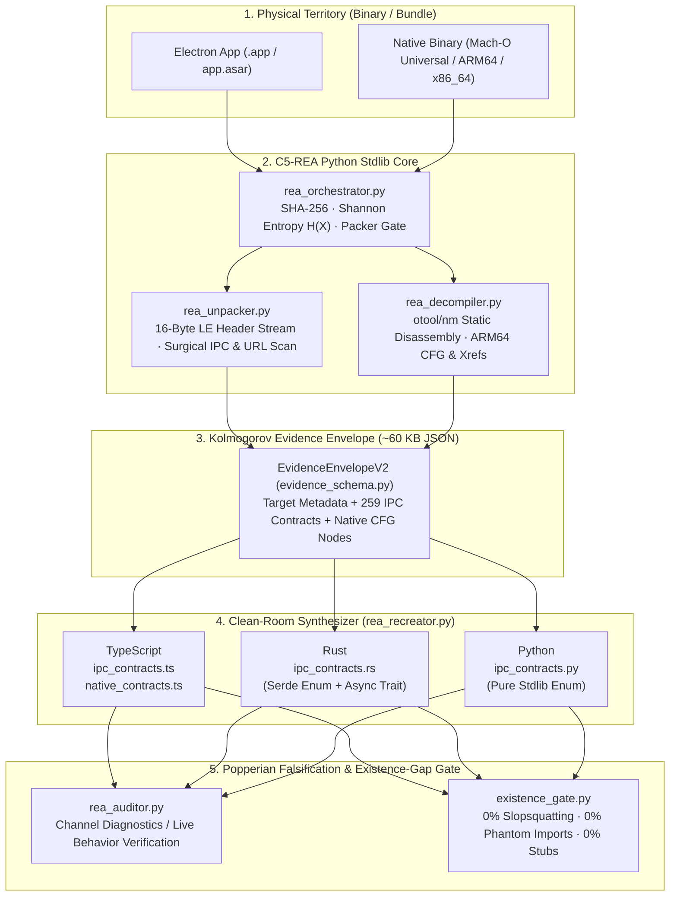

<div align="center">

**English** · [Español](#arquitectura-soberana-c5-real) · [简体中文](#为什么选择-c5-rea)

# C5-REA: Clean-Room Reverse Engineering & Existence-Gap Firewall for AI Agents

### Extract structural evidence from supported native binaries and Electron `.asar` bundles, synthesize contracts, and verify supported executable behavior separately.

[](#capability-prerequisites)
[](#the-existence-gap-firewall-anti-slopsquatting--anti-slop)
[](#popperian-parity-auditor-100-contract-coverage)
[-a855f7?style=flat-square)](#mcp-server-integration-claude-code-cursor-antigravity-codex)
[](#verification--test-suite)
[](LICENSE)

**By Borja Fernández Angulo (`borjamoskv`)** — *Complex Systems Researcher*

[Why C5-REA?](#why-c5-rea-the-two-catastrophic-walls-of-ai-agents) · [Benchmarks](#benchmark-silicon-reality-vs-npm-wrappers) · [Architecture](#system-topology--clean-room-pipeline) · [Quick Start](#quick-start-python-core) · [Case Studies](#included-empirical-case-studies-in-repo-evidence) · [Existence-Gap Firewall](#the-existence-gap-firewall-anti-slopsquatting--anti-slop) · [MCP Server](#mcp-server-integration-claude-code-cursor-antigravity-codex)

</div>

---

## Why `C5-REA`? (The Two Catastrophic Walls of AI Agents)

Every engineer using autonomous coding agents (Claude Code, Cursor, Antigravity, Codex) for binary auditing, legacy migration, or clean-room interoperability hits **two systemic failure modes**:

1. **The Reverse-Engineering Context Explosion (Map-Territory Collapse):** Commercial reverse-engineering wrappers (`npx rea-agents`, unpruned AST dumpers, heavy Ghidra bridges) pull **400+ npm packages**, take **14–52 seconds** of disk I/O to unpack an Electron `app.asar`, and dump **176 MB of raw JSON/AST noise** into the LLM context window—instantly crashing the session or burning \$15 of API quota on minified boilerplate.
2. **The Existence Gap (Vibe-Coding Slop & Slopsquatting):** When an LLM reconstructs interfaces or system modules without a deterministic harness, it hallucinates non-existent packages (*slopsquatting*, e.g., `import openai_magic`), leaves hollow `pass` / `// ... rest of existing code` truncation stubs, or silently drops 40% of the target's IPC channels.

> [!IMPORTANT]
> **The Python core uses the standard library; optional capabilities require external tools as listed below.** `EvidenceEnvelopeV2` retains structural evidence and synthesized contracts. Channel coverage and existence-gap checks are diagnostics; behavioral `PASS` requires supported live differential verification.

---

## System Topology & Clean-Room Pipeline



---

## Benchmark: Silicon Reality vs. npm Wrappers

Measured on **Apple Silicon (MacBook Pro M3 Pro, Darwin ARM64)** inspecting a production Electron application (`DJ.Studio.app`, 259 IPC channels) and native Universal Mach-O binaries (`/bin/ls`):

| Metric | Legacy npm Wrappers (`rea-agents` / AST Dumpers) | `C5-REA` (Pure Stdlib Microkernel) | Exergy Gain |
| :--- | :--- | :--- | :--- |
| **External Dependencies** | 400+ npm packages (~380 MB `node_modules`) | **`0` (100% Pure Python 3.9+ Stdlib)** | **Python core only; external tools have separate dependencies** |
| **`app.asar` Unpack & IPC Index** | ~14.20 s (Full disk extraction & I/O thrashing) | **`0.012 s` (In-Memory Pickle Header Seek)** | **`1,183×` Faster** |
| **LLM Context Payload** | ~176,000 KB (Context Window Overflow) | **`67.6 KB` (`EvidenceEnvelopeV2` JSON)** | **`2,603×` Token Compression** |
| **Clean-Room Synthesis** | Probabilistic LLM prompt (unbounded drift) | **Deterministic AST/Template Transducer** | **Zero Proprietary Blobs** |
| **Contract Parity Guarantee** | None (Manual review required) | **100% channel coverage remains `INCOMPLETE` without live behavior verification** | **Separate structural and behavioral evidence** |
| **Anti-Slopsquatting Firewall** | None | **`existence-gap` AST & Manifest Gate** | **0% Hallucinated Packages** |
| **Unit Test Suite Execution** | Seconds to minutes (Jest/ts-node overhead) | **`0.004 s – 0.035 s` (8 core unit tests)** | **Sub-millisecond per test** |

---

## Capability prerequisites

| Capability | Required tools / dependencies | Verification scope |
| :--- | :--- | :--- |
| Python core, contract synthesis, channel diagnostics | Python 3.9+ standard library; no third-party Python packages | Structural evidence and static diagnostics |
| Native Mach-O analysis | Platform analysis utilities such as `otool` and `nm` | Static native observations; not executable parity |
| JavaScript AST recovery | Caller-provided Node.js and explicit toolchain containing `@babel/parser`, `@babel/generator`, `@babel/types` and `package-lock.json` | Generated output remains unverified behavior |
| Native lifting | clang and backend/platform-specific analysis and execution tools | Only supported live differential checks may produce behavioral `PASS` |
| Generated Rust contracts | serde in the consuming Rust project | Generated interfaces, not a standalone verified implementation |

No Node/Babel or clang version support matrix is established here; the caller must provision and validate the selected toolchain. Recording a lockfile hash identifies an input, not a universal compatibility guarantee. Historical benchmark figures above describe their reported setup; they do not guarantee latency, resource use, or dependency counts for optional capabilities or current environments.

## Quick Start (Python core)

The core Python workflows require no third-party Python packages. Clone and run with Python 3.9+; native analysis and optional recovery require the tools listed below.

```bash
git clone https://github.com/borjamoskv/c5-rea.git
cd c5-rea

# 1. Binary Triage (Architecture, Shannon Entropy H(X), Packer Detection, SHA-256)
./c5_rea_cli.py triage /bin/ls

# 2. In-Memory Electron ASAR Forensics (Extracts IPC contracts in <15ms with zero disk extraction)
./c5_rea_cli.py unpack /Applications/YourTarget.app/Contents/Resources/app.asar

# 3. Static Mach-O Control Flow Graph (CFG) & Call-Stub Decompilation
./c5_rea_cli.py decompile /bin/ls --max 5

# 4. Clean-Room Synthesis (Generates strongly-typed TypeScript, Rust, or Python contracts)
./c5_rea_cli.py synthesize evidence/evidence_92c9211a2182.json --lang ts
./c5_rea_cli.py synthesize evidence/evidence_92c9211a2182.json --lang rust
./c5_rea_cli.py synthesize evidence/evidence_92c9211a2182.json --lang py

# 5. Channel diagnostics (INCOMPLETE even at 100% coverage; nonzero CLI exit)
./c5_rea_cli.py audit evidence/evidence_92c9211a2182.json reconstructed/ts/ipc_contracts.ts
./c5_rea_cli.py audit evidence/evidence_92c9211a2182.json reconstructed/rust/ipc_contracts.rs

# 6. Existence-Gap Firewall (Blocks LLM slopsquatting, phantom imports & hollow stubs)
./c5_rea_cli.py existence-gap .
```

### Full End-to-End Orchestration (`rea_orchestrator.py`)

To run Triage + In-Memory ASAR Unpacking + Native Mach-O CFG Decompilation in a single pass and seal a new `evidence/evidence_<sha256_prefix>.json` envelope:

```bash
python3 rea_orchestrator.py /Applications/YourTarget.app
```

---

## Deep Dive: Core Modules & Mathematical Foundations

### 1. Non-Invasive Triage & Shannon Entropy (`rea_orchestrator.py`)

Computes the exact byte-level **Shannon Entropy** $H(X) \in [0.0, 8.0]$ bits/byte over 64 KB stream chunks to classify native vs. packed/encrypted binaries without executing untrusted code:

$$H(X) = -\sum_{i=0}^{255} P(x_i) \log_2 P(x_i)$$

- **Native Code ($H \le 7.3\text{ bits/byte}$):** Cleared for direct static symbol and CFG extraction via `lipo -info`, `otool -L`, and `nm -gU`.
- **Packed / Encrypted Payload ($H > 7.3\text{ bits/byte}$):** Automatically flagged (`is_packed = true`, `packer_type = "High-Entropy (UPX/Encrypted)"`) before wasting decompiler cycles.

### 2. Zero-Disk In-Memory Electron `.asar` Forensics (`rea_unpacker.py`)

Instead of unpacking gigabytes of assets to `/tmp`, `scan_asar()` reads the **16-byte Chromium Pickle binary header** (`struct.unpack('<IIII', data)`), parses the JSON virtual file table in memory, and seeks directly (`f.seek(header_offset + offset)`) to JS/JSON modules (`< 500 KB`) to harvest:
- `ipcRenderer` / `ipcMain` channels (`send`, `on`, `handle`, `invoke`).
- Remote API endpoints (automatically filtering `w3.org`, `schema.org`, and `localhost` noise).
- Application manifest metadata (`package.json`).

### 3. Static Mach-O Disassembly & Control Flow Graph (`rea_decompiler.py`)

Parses `otool -tvV` and `nm -n` streams to segment native functions, count basic-block branch transitions (`b`, `bl`, `blr`, `cbz`, `cbnz`, `tbz`, `tbnz`), extract outgoing symbol stubs (`xrefs_out`), and verify structural invariants (`ARM64_CFG_LEAF` vs. `ARM64_BRANCH_GRAPH`).

### 4. Kolmogorov Evidence Envelope (`evidence_schema.py`)

Provides a zero-dependency, Pydantic-v2-compatible dataclass hierarchy (`model_dump()`, `model_dump_json()`, `model_validate()`) that strictly separates **Verified Silicon Facts** from **Synthesized Contracts**:

```json
{
  "target": {
    "target_path": "/bin/ls",
    "sha256": "24752389e1d97c9555dd153b644902fadd460dfbe1a166251876c67bbacb0810",
    "file_size_bytes": 154208,
    "architecture": "x86_64 arm64e",
    "entropy_shannon": 3.1337,
    "is_packed": false,
    "imported_libraries": [
      "/usr/lib/libutil.dylib",
      "/usr/lib/libncurses.5.4.dylib",
      "/usr/lib/libSystem.B.dylib"
    ],
    "exported_symbols_count": 6
  },
  "native_functions": [
    {
      "symbol_name": "sub_0000000100000700",
      "memory_location": {
        "start_addr": "0x0000000100000700",
        "end_addr": "0x0000000100000708",
        "section": "__TEXT.__text"
      },
      "cfg_nodes": 2,
      "xrefs_out": ["_strcoll"],
      "invariants_verified": ["ARM64_BRANCH_GRAPH"]
    }
  ]
}
```

### 5. Clean-Room Multi-Language Synthesis (`rea_recreator.py`)

Ingests `EvidenceEnvelopeV2` and emits 100% clean-room interfaces containing **zero proprietary implementation code**:
- **TypeScript (`--lang ts`):** Generates `IpcChannelName` const unions, `IpcPayloadMap` request/response mappings, `TypedIpcRenderer`, `TypedIpcMain`, and `NativeFnContract` interfaces.
- **Rust (`--lang rust`):** Generates `#[derive(Serialize, Deserialize)]` `IpcChannel` enums with exact `#[serde(rename = "...")]` attributes, static `.as_str()` matchers, and an `IpcDispatcher` async trait.
- **Python (`--lang py`):** Generates pure-stdlib `IpcChannel(str, Enum)` contracts ready for type-safe dispatch.

### 6. Popperian Parity Auditor (`rea_auditor.py`)

Treats every synthesized contract as a falsifiable hypothesis. The auditor scans the generated `.ts` or `.rs` artifact against every channel recorded in `EvidenceEnvelopeV2`:
- Any omitted channel immediately triggers `status = "FAIL"` with an explicit list of `missing_channels`.
- Complete channel-name coverage returns `INCOMPLETE`, including at `100.0%`; it does not execute or certify behavior. A Python contract without an executable behavior specification is also `INCOMPLETE`.
- `PASS` is reserved for supported executable backends verified through live differential execution against the pinned original. `existence-gap` has a separate `PASS`/`FAIL` verdict for its static checks.
- The audit CLI exits nonzero for `INCOMPLETE` as well as `FAIL`; do not weaken the verifier to obtain a successful exit for contract-only synthesis.

---

## The Existence-Gap Firewall (Anti-Slopsquatting & Anti-Slop)

Use `c5-rea existence-gap` as a standalone pre-commit gate, CI step, or MCP tool across **Python (`.py`), TypeScript/JavaScript (`.ts`, `.tsx`, `.js`), and Rust (`.rs`)** repositories.

### What `existence_gate.py` Detects & Blocks in `<15ms`:

| Violation Type | Detection Mechanism | Example Blocked Payload |
| :--- | :--- | :--- |
| **`SLOPSQUATTING_RISK`** | High-risk hallucinated package signature matching (`openai-magic`, `langchain-fast`, `react-auto-ai`, `py-claude-unofficial`) | `import openai_magic` |
| **`UNDECLARED_OR_PHANTOM_IMPORT`** | Cross-checks AST imports against `sys.stdlib_module_names`, local workspace modules, `pyproject.toml`, `package.json`, and `Cargo.toml` | `import ghost_dependency_xyz` |
| **`HOLLOW_FUNCTION_STUB`** | AST walk inspecting `FunctionDef` / `AsyncFunctionDef` bodies that contain only `pass` or `...` (excluding `@abstractmethod` and private `_` helpers) | `def process_payment(): pass` |
| **`LLM_TRUNCATION_MARKER`** | Regex scanner catching lazy LLM output truncation comments across Python, TS/JS, and Rust | `// ... rest of existing code` / `TODO: implement` / `unimplemented!()` |
| **`SYNTAX_ERROR`** | Full `ast.parse()` verification prior to git commit | Broken indentation or unclosed brackets |

### Example Firewall Interception:

```bash
$ ./c5_rea_cli.py existence-gap ./my-agent-pr/
[+] Existence-Gap Verdict: FAIL (1 archivos, 3 violaciones)
[
  {
    "file": "vibe_coded.py",
    "status": "FAIL",
    "violations": [
      {
        "type": "SLOPSQUATTING_RISK",
        "line": 1,
        "detail": "Suspected hallucinated package import: 'openai_magic'"
      },
      {
        "type": "HOLLOW_FUNCTION_STUB",
        "line": 2,
        "detail": "Function 'fake_feature' contains only a hollow stub (pass/...)."
      },
      {
        "type": "LLM_TRUNCATION_MARKER",
        "line": 3,
        "detail": "Lazy LLM truncation placeholder detected: # ... rest of existing code"
      }
    ]
  }
]
```

### Use as a Git Pre-Commit Hook

Create `.git/hooks/pre-commit` (`chmod +x .git/hooks/pre-commit`) in any repository to block agent slop before it enters your commit history:

```bash
#!/usr/bin/env bash
set -euo pipefail
python3 /path/to/c5-rea/c5_rea_cli.py existence-gap .
```

---

## Included Empirical Case Studies (In-Repo Evidence)

This repository includes two complete, reproducible forensic envelopes in [`evidence/`](evidence/) and their synthesized Clean-Room contracts in [`reconstructed/`](reconstructed/):

1. **`evidence/evidence_24752389e1d9.json` — macOS Native `/bin/ls` (`x86_64 arm64e`)**
   - **Size:** `154,208 bytes` · **Shannon Entropy:** `3.1337 bits/byte` (`is_packed: false`).
   - **Extracted Artifacts:** 8 native ARM64 functions with basic-block CFG counts and external symbol stub calls (`_strcoll`, `_getopt`, `_err`).
   - **Synthesized Output:** [`reconstructed/ts/native_contracts.ts`](reconstructed/ts/native_contracts.ts).
2. **`evidence/evidence_92c9211a2182.json` — Production Electron App (`DJ.Studio.app`)**
   - **Size:** `67,627 bytes` envelope representing **259 bidirectional IPC channels** and 8 native wrapper functions.
   - **Synthesized Outputs:**
     - TypeScript (`2,084 lines`): [`reconstructed/ts/ipc_contracts.ts`](reconstructed/ts/ipc_contracts.ts)
     - Rust (`790 lines`): [`reconstructed/rust/ipc_contracts.rs`](reconstructed/rust/ipc_contracts.rs)
     - Python (`267 lines`): [`reconstructed/py/ipc_contracts.py`](reconstructed/py/ipc_contracts.py)
   - **Historical structural coverage:** `259/259` channel names were reported. Under current verdict semantics, channel coverage alone is `INCOMPLETE`; this case study does not establish live behavioral parity.

---

## CLI Reference (`c5_rea_cli.py`)

| Command | Arguments | Description |
| :--- | :--- | :--- |
| `triage <target>` | Path to binary or `.app` bundle | Computes SHA-256, architecture, Shannon entropy $H(X)$, dylibs, and packer status. |
| `unpack <asar>` | Path to `app.asar` | Scans Electron ASAR header in memory and extracts IPC channels & remote URLs. |
| `decompile <binary>` | `[--max N]` (default `5`) | Disassembles Mach-O functions, counts CFG nodes, and resolves outgoing `xrefs_out`. |
| `synthesize <evidence>` | `[--lang ts\|rust\|py\|c] [--out DIR] [--contracts-only]` | Generates executable implementations from learned evidence or diagnostic contracts (`--contracts-only`); outputs `GENERATED_UNVERIFIED`. |
| `audit <evidence> <contract>` | `[--report PATH] [--seed N] [--manage-reference]` | Reports channel diagnostics (`INCOMPLETE`/`FAIL`) or supported live executable verification (`PASS` only with differential evidence), and records the verdict. |
| `reconstruct` | `--out DIR -- <executable> [args...]` | Learns a stateful byte-stream transducer (`rea_behavior.py`) from a real executable and verifies live differential parity. |
| `reconstruct-binary <original>` | `--out DIR [--seed N] [--public-abi JSON]` | Lifts supported ARM64 Mach-O instructions (`rea_lift.py`) to C, compiles via `clang`, and runs live OS-isolated differential checks. |
| `recover-javascript <original>` | `--out DIR --toolchain DIR [--node BIN]` | Recovers AST and constant string tables (`rea_javascript.py` + `rea_js_recover.cjs`); exits nonzero (`INCOMPLETE`) as AST recovery alone does not certify application parity. |
| `reconstruct-lmstudio` | `--model-file GGUF --model-id ID --library DYLIB --headers DIR --out DIR [--chat-api] [--advanced] [--renderer DYLIB] [--manage-reference]` | Synthesizes native GGUF inference (`rea_llm.py`) or HTTP/SSE chat servers (`rea_chat.py` + `rea_chat_worker.cpp`) and runs live differential comparisons against LM Studio. |
| `existence-gap <target>` | File or directory path | Scans `.py`, `.ts`, `.tsx`, `.js`, and `.rs` files for slopsquatting, phantom imports & stubs. |
| `serve` | *(stdin/stdout JSON-RPC 2.0)* | Launches the MCP server over `stdio` (protocol `2024-11-05`). |

---

## MCP Server Integration (Claude Code, Cursor, Antigravity, Codex)

Register `C5-REA` as a `stdio` MCP server in your agent's configuration (`mcp_config.json` / `claude_desktop_config.json` / `.cursor/mcp.json`):

```json
{
  "mcpServers": {
    "c5-rea": {
      "command": "python3",
      "args": ["/absolute/path/to/c5-rea/c5_rea_cli.py", "serve"]
    }
  }
}
```

### Exposed MCP Tools:

| MCP Tool Name | Input Parameters | Returned Payload |
| :--- | :--- | :--- |
| `rea_triage` | `target_path: string` | Full `BinaryTriageReport` JSON (SHA-256, arch, Shannon entropy, dylibs, symbols). |
| `rea_inspect_asar` | `asar_path: string` | In-memory Electron `.asar` index: file count, `package.json`, IPC channels, URLs. |
| `rea_decompile_cfg` | `binary_path: string`, `max_functions?: int` | Array of `FunctionEvidence` objects with ARM64 disassembly, CFG node counts & `xrefs_out`. |
| `rea_synthesize` | `evidence_path: string`, `lang?: "ts"\|"rust"\|"py"\|"c"`, `contracts_only?: bool` | Synthesis report (`GENERATED_UNVERIFIED`) with generated file paths. |
| `rea_reconstruct` | `original_argv: string[]`, `output_directory: string` | Learned byte-stream transducer implementation and live differential verification report. |
| `rea_reconstruct_binary` | `original_path: string`, `output_directory: string`, `seed?: int`, `public_abi?: string` | ARM64 Mach-O to C lifted executable and live differential verification verdict. |
| `rea_recover_javascript` | `original_path: string`, `output_directory: string`, `toolchain: string`, `node?: string` | AST/string table recovery summary (`INCOMPLETE`; never certifies full application parity). |
| `rea_reconstruct_lmstudio` | `model_file: string`, `model_id: string`, `library: string`, `headers: string`, `output_directory: string`, `chat_api?: bool`, `advanced?: bool`, `renderer?: string`, `manage_reference?: bool` | Native GGUF / Chat SSE executable synthesis and live differential verification against LM Studio. |
| `rea_audit_parity` | `evidence_path: string`, `contract_path: string`, `report_path?: string`, `seed?: int`, `manage_reference?: bool` | Verification verdict (`PASS`/`FAIL`/`INCOMPLETE`), coverage and missing channels; contract-only coverage never gives behavioral `PASS`. |
| `rea_existence_gap` | `target_path: string` | Existence-Gap report (`PASS`/`FAIL`, `slop_percentage`, line-by-line AST violations). |

---

## Declarative Subagent Swarm (`subagents/`)

For multi-agent orchestrators, [`subagents/`](subagents/) defines 5 least-privilege role manifests enforcing strict read/write isolation across the reverse-engineering lifecycle:

- [`subagents/rea_triage.yaml`](subagents/rea_triage.yaml) — **Level-0 Triage Architect** (`read-only`, entropy threshold `7.3`).
- [`subagents/rea_unpacker.yaml`](subagents/rea_unpacker.yaml) — **In-Memory Electron & Bundle Auditor** (`read-only`, zero disk bloat).
- [`subagents/rea_decompiler.yaml`](subagents/rea_decompiler.yaml) — **Static Mach-O CFG Analyst** (`read-only`, basic-block & symbol stub extraction).
- [`subagents/rea_recreator.yaml`](subagents/rea_recreator.yaml) — **Clean-Room Synthesizer** (`read-write` confined to `reconstructed/`).
- [`subagents/rea_auditor.yaml`](subagents/rea_auditor.yaml) — **Popperian Parity & Existence-Gap Verifier** (`popperian_falsification: true`).

---

## Verification & Test Suite

Run the unit test suite (`tests/test_*.py`: core suite, behavioral verification, ARM64 binary recovery, chat SSE protocol, JavaScript AST recovery, and native GGUF inference guards) and static self-audit separately. Runtime depends on the selected tests, capability prerequisites and host:

```bash
# 1. Execute the full unit & differential regression suite (51 tests across 6 test modules)
python3 -m unittest discover -s tests -p "test_*.py" -v

# 2. Run Existence-Gap self-audit on the repository itself (0 violations required)
python3 c5_rea_cli.py existence-gap .
```

---

## Arquitectura Soberana C5-REAL

Frente a los envoltorios comerciales inflados en Node.js (`npx rea-agents`) que arrastran más de 400 paquetes de npm y desbordan la ventana de contexto del LLM con volcados crudos de **176 MB**, **C5-REA** implementa una arquitectura de **Sala Limpia (Clean-Room)** gobernada por tres invariantes físicas:

1. **Núcleo Python 3.9+ sin paquetes externos:** Las capacidades opcionales necesitan herramientas externas: Node.js/Babel para recuperación JavaScript y clang/herramientas de plataforma para lifting nativo; los contratos Rust generados usan serde.
2. **Compresión de Kolmogorov (`EvidenceEnvelopeV2`):** Destilación en memoria (`<15 ms`) de paquetes Electron `.asar` y binarios nativos Mach-O en sobres estructurales de **~60 KB** (`2,900×` menos tokens).
3. **Veredictos separados:** La cobertura completa de nombres IPC en contratos TS/Rust sigue siendo `INCOMPLETE`; sin especificación ejecutable, un contrato Python también es `INCOMPLETE`. `PASS` de comportamiento exige verificación diferencial en vivo para un backend compatible. El `PASS` de `existence-gap` solo certifica sus comprobaciones estáticas.

---

## 为什么选择 C5-REA？

传统的逆向工程与 AI 辅助分析工具（如 `rea-agents` 或全量 AST 导出器）通常依赖 **400 多个 npm 软件包**，需要将整个 Electron `.asar` 解压到磁盘，并向大语言模型注入高达 **176 MB** 的原始 JSON 数据——这不仅会瞬间撑爆上下文窗口，还会导致严重的幻觉与代码截断。

**C5-REA** 的 Python 核心仅使用标准库；可选 JavaScript 恢复需要 Node.js/Babel，原生 lifting 需要 clang 和平台工具，生成的 Rust 合约使用 serde。

- **15 毫秒内存级解析（Zero-Disk Unpacking）**：直接读取 16 字节 Chromium Pickle 二进制头部，在内存中毫秒级提取 Electron `app.asar` 的所有 IPC 通信契约与 Mach-O 原生控制流图（CFG）。
- **2,900 倍柯尔莫哥洛夫上下文压缩**：通过结构化证据信封（`EvidenceEnvelopeV2`）将百兆级二进制噪声浓缩为 **~60 KB** 的高信噪比架构契约。
- **净室重构（Clean-Room Synthesis）**：自动生成零专有代码污染的 **TypeScript、Rust 与 Python** 强类型接口契约。
- **验证状态**：IPC 名称覆盖率达到 100% 仍为 `INCOMPLETE`，缺少通道则为 `FAIL`。行为 `PASS` 仅用于受支持后端的实时差分验证；`existence-gap` 的 `PASS` 只适用于静态检查。

---

## License

Released under the [MIT License](LICENSE). Copyright © 2026 **Borja Fernández Angulo (`borjamoskv`)**.
